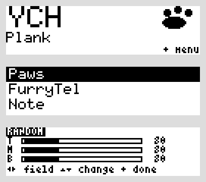
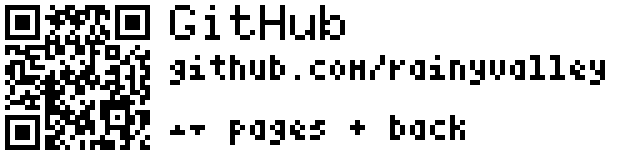
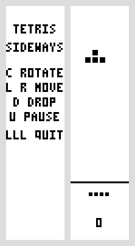

# Furrytel BadgeOS — Tines Edition

A friendly firmware for the [FurryTel badge](https://furrytel.net): your name and a paw, your links
as big QR codes, pictures and a scratch note, and a few games for when you are waiting in line.



## What it does

- **Home**: your name, a paw, and your species or title underneath.
- **Files**: pictures (baked in from `badge.yaml`) and one note you type on the badge with the
  on-screen keyboard. The note is kept in flash, so it survives changing the batteries.
- **Links**: one page per link, each with the biggest QR code a 32-pixel-tall screen allows. Here is
  an example card:

  

- **Games**: Snake, Flappy, Crossy (a new level every ten lanes), and a knock-off Tetris. The D-pad
  plays; three Lefts leave a game so a stray press does not (in Tetris, Left pauses, so three
  Downs leave). Tetris is drawn sideways — turn the badge clockwise to play:

  
- **Colors**: presets and RGB sliders for the backlight, plus a separate color for the flash on
  every button press.
- **LEDs**: the three little lights can blink randomly, hold a color, chase, or glow when you press
  a button.
- **About / Status / Bootloader**: firmware info, battery and uptime, and a reboot into the USB
  bootloader for reflashing.
- **A secret**: enter ↑↑↓↓←→←→●● on the home screen to open Snake.

## Make it yours

Everything personal is in [`badge.yaml`](badge.yaml):

```yaml
name: YCH             # up to 8 characters look best; longer names use a narrower font
species: Grungler     # up to 10 characters

links:
  - title: GitHub
    url: https://github.com/rainyvalley

pictures:
  - name: Paws
    image: art/paws.png
  - name: FurryTel
    image: art/furrytel.png
```

A name of up to 8 characters uses the big font; longer names shrink to fit, and 16 characters is
the hard limit. Each link's URL has to fit a 29×29 QR code, about 53 characters.

Pictures are fitted inside the screen, centred, and turned into black and white; small images stay
small unless you set `scale: 2` (or use `dither: true` / `threshold: 128` for a different look).
Logos and line art work best.

Then rebuild:

```sh
rustup target add thumbv6m-none-eabi                     # once; rust-toolchain.toml pins the rest
python3 -m pip install --user pyyaml pillow qrcode       # or use a virtualenv
python3 tools/build.py            # writes dist/badgeos.uf2
```

`tools/build.py` regenerates the QR codes and pictures, compiles the firmware, and wraps it as a
UF2 file.

**More than one badge?** Copy `badge.yaml` to `badges/someone.yaml`, edit it, and build that one:

```sh
mkdir -p badges
cp badge.yaml badges/someone.yaml
python3 tools/build.py --config badges/someone.yaml   # writes dist/someone.uf2
```

Only one config is generated at a time (`src/generated.rs`), so rebuild with your own before
flashing your own badge.

## Flashing

1. Put the badge in bootloader mode — either hold the small **BOOTSEL** button on the board while
   plugging the USB cable in, or pick **Bootloader** in the badge's menu and press Center.
2. Copy your `.uf2` file onto the drive that appears, called `RPI-RP2`.
3. The badge restarts by itself.

## Controls

| Where | What the buttons do |
| --- | --- |
| Home | Center or Left opens the menu |
| Menu | Up/Down move, Center or Right open, Left goes back |
| Files | Up/Down pick a file, Center or Right opens it, any button closes a picture, Left goes back |
| Note | D-pad moves around the keyboard, `OK` saves, `esc` cancels |
| Links | Up/Down or Left/Right turn pages, Center goes back |
| Games | D-pad plays, Center starts/pauses/retries, three Lefts quit (Flappy flaps on Center) |
| Tetris | turn the badge clockwise — the buttons turn with it: up=right, down=left, left=pause, right=drops to the bottom, Center rotates |
| Colors | Left/Right pick a field, Up/Down change it, Center saves and finishes |
| LEDs | Left/Right pick a field, Up/Down change it, Center saves and finishes |
| About / Status | any button turns the page or leaves |
| Bootloader | Center reboots into USB bootloader, any other button leaves |

## Credits

This is an unofficial project, built on the [FurryTel badge firmware][original] and the
[FurryTel badge hardware][hardware] from [furrytel.net](https://furrytel.net). Thank you! The
FurryTel name and logo are theirs, and the original display, menu and keyboard code is the
foundation everything here stands on.

The original firmware does not include a license file, so if you plan to redistribute this project,
please check with the FurryTel project first.

[FurryTel](https://furrytel.net) · [original firmware][original] · [hardware][hardware]

## A note on AI assistance

Parts of this project — code, configuration, and documentation — were written with the help of generative AI. Everything in here was reviewed, tested, and corrected by a human before being committed; nothing was accepted on the model's say-so.

## License

MIT — see [LICENSE](LICENSE).

[original]: https://github.com/FurryTel/badge-firmware
[hardware]: https://github.com/FurryTel/badge
